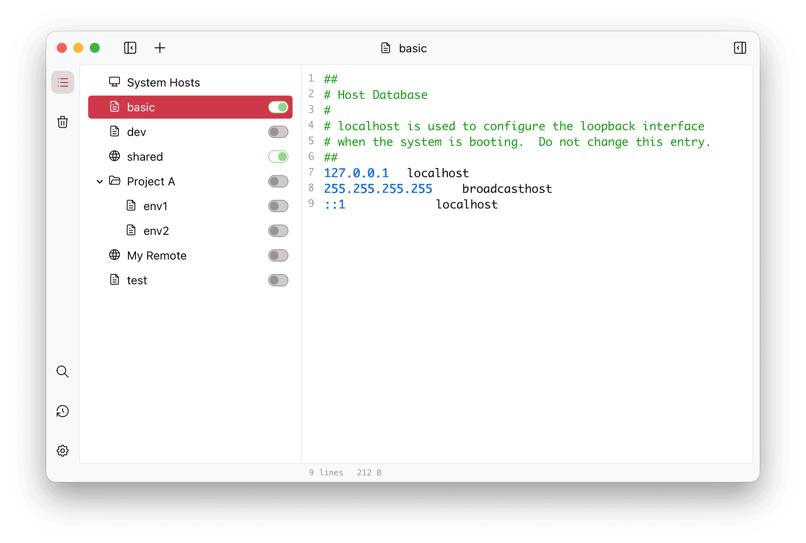

<div align="center" markdown="1">
  <sup>Special thanks to:</sup>
  <br>
  <a href="https://go.warp.dev/SwitchHosts">
    
  </a>

### [Warp, the intelligent terminal for developers](https://go.warp.dev/SwitchHosts)

[Available for MacOS, Linux, & Windows](https://go.warp.dev/SwitchHosts)<br>

</div>

---

# SwitchHosts

Manage and switch hosts files with ease. Built with [Tauri](https://tauri.app/) and [React](https://react.dev/).

[Homepage](https://switchhosts.app) · [简体中文](README.zh_hans.md) · [繁體中文](README.zh_hant.md) · [Polski](README.pl.md) · [Türkçe](README.tr.md)



## Features

- Organize local and remote hosts in groups and folders
- Switch hosts from the main window or system tray
- Edit with syntax highlighting and find and replace
- Refresh remote hosts automatically; import and export backups

## Download

Get SwitchHosts from [GitHub Releases](https://github.com/oldj/SwitchHosts/releases), or install on Windows with [Chocolatey](https://community.chocolatey.org/packages/switchhosts): `choco install switchhosts`.

## Documentation & development

See the [guide](docs/guide.md) for editing hosts, backups, the local HTTP API, and build prerequisites.

```bash
npm install
npm run tauri:dev    # development
npm run tauri:build  # production build
```

## Copyright

SwitchHosts is a free and open source software, it is released under the [Apache License](./LICENSE).
