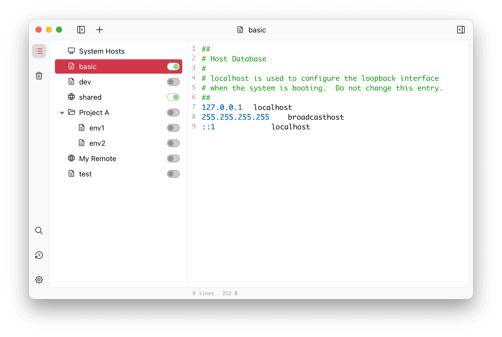

<div align="center" markdown="1">
  <sup>Special thanks to:</sup>
  <br>
  <a href="https://go.warp.dev/SwitchHosts">
    
  </a>

### [Warp, the intelligent terminal for developers](https://go.warp.dev/SwitchHosts)
[Available for MacOS, Linux, & Windows](https://go.warp.dev/SwitchHosts)<br>

</div>

---

# SwitchHosts

Łatwo zarządzaj plikami hosts i przełączaj je. Aplikacja oparta na [Tauri](https://tauri.app/) i [React](https://react.dev/).

[Strona główna](https://switchhosts.app) · [English](README.md) · [简体中文](README.zh_hans.md) · [繁體中文](README.zh_hant.md) · [Türkçe](README.tr.md)



## Funkcje

- Organizowanie lokalnych i zdalnych plików hosts w grupy i foldery
- Przełączanie hosts z głównego okna lub zasobnika systemowego
- Edycja z podświetlaniem składni, wyszukiwaniem i zamianą
- Automatyczne odświeżanie zdalnych hosts oraz import i eksport kopii zapasowych

## Pobieranie

Pobierz SwitchHosts z [GitHub Releases](https://github.com/oldj/SwitchHosts/releases) lub zainstaluj w systemie Windows przez [Chocolatey](https://community.chocolatey.org/packages/switchhosts): `choco install switchhosts`.

## Dokumentacja i rozwój

Informacje o kopiach zapasowych i wymaganiach dotyczących budowania znajdziesz w [poradniku](docs/guide.pl.md). Edycję hosts i lokalne HTTP API opisuje [poradnik w języku angielskim](docs/guide.md).

```bash
npm install
npm run tauri:dev    # tryb deweloperski
npm run tauri:build  # wersja produkcyjna
```

## Prawa autorskie

SwitchHosts to wolne i otwarte oprogramowanie, wydane na licencji [Apache License](./LICENSE).
