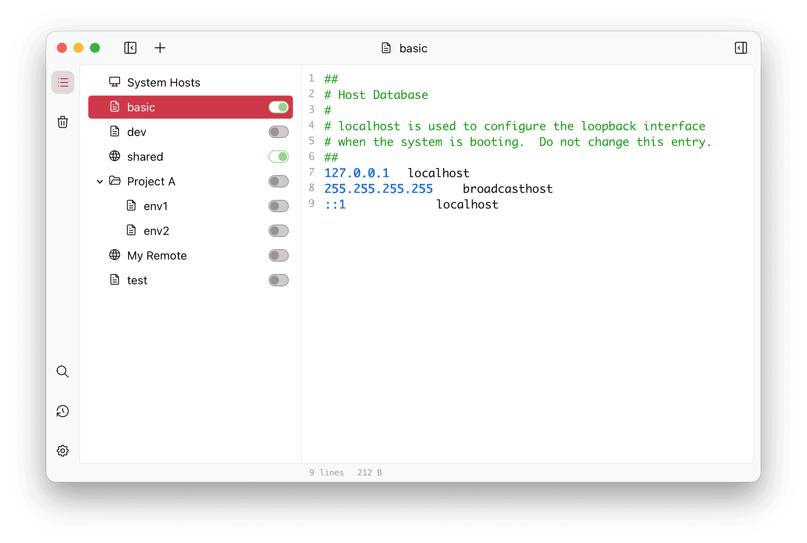

<div align="center" markdown="1">
  <sup>Special thanks to:</sup>
  <br>
  <a href="https://go.warp.dev/SwitchHosts">
    
  </a>

### [Warp, the intelligent terminal for developers](https://go.warp.dev/SwitchHosts)
[Available for MacOS, Linux, & Windows](https://go.warp.dev/SwitchHosts)<br>

</div>

---

# SwitchHosts

Hosts dosyalarını kolayca yönetin ve aralarında geçiş yapın. [Tauri](https://tauri.app/) ve [React](https://react.dev/) ile geliştirilmiştir.

[Ana sayfa](https://switchhosts.app) · [English](README.md) · [简体中文](README.zh_hans.md) · [繁體中文](README.zh_hant.md) · [Polski](README.pl.md)



## Özellikler

- Yerel ve uzak hosts dosyalarını grup ve klasörlerle düzenleyin
- Ana pencereden veya sistem tepsisinden hosts dosyaları arasında geçiş yapın
- Sözdizimi vurgulama, bulma ve değiştirme ile düzenleyin
- Uzak hosts dosyalarını otomatik yenileyin; yedekleri içe ve dışa aktarın

## İndirme

SwitchHosts'u [GitHub Releases](https://github.com/oldj/SwitchHosts/releases) üzerinden indirin veya Windows'ta [Chocolatey](https://community.chocolatey.org/packages/switchhosts) ile kurun: `choco install switchhosts`.

## Belgeler ve geliştirme

Hosts düzenleme, yedekleme, yerel HTTP API ve derleme ön koşulları için [kılavuza](docs/guide.tr.md) bakın.

```bash
npm install
npm run tauri:dev    # geliştirme
npm run tauri:build  # üretim derlemesi
```

## Telif hakkı

SwitchHosts ücretsiz ve açık kaynaklı bir yazılımdır; [Apache Lisansı](./LICENSE) altında yayımlanmaktadır.
