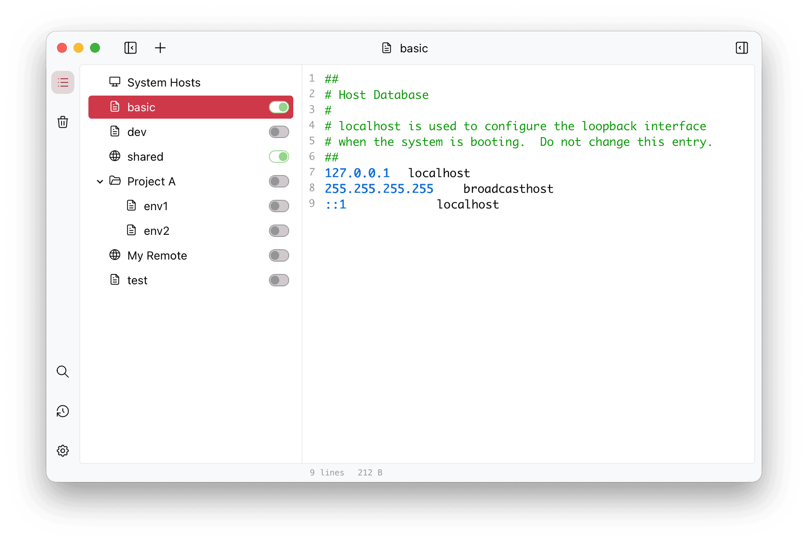

<div align="center" markdown="1">
  <sup>Special thanks to:</sup>
  <br>
  <a href="https://go.warp.dev/SwitchHosts">
    
  </a>

### [Warp, the intelligent terminal for developers](https://go.warp.dev/SwitchHosts)
[Available for MacOS, Linux, & Windows](https://go.warp.dev/SwitchHosts)<br>

</div>

---

# SwitchHosts

- [English](README.md)
- [Polski](README.pl.md)
- [简体中文](README.zh_hans.md)
- [繁體中文](README.zh_hant.md)

Ana sayfa: [https://switchhosts.app](https://switchhosts.app)

SwitchHosts, hosts dosyasını yönetmek için geliştirilmiş bir uygulamadır; [Tauri](https://tauri.app/), [React](https://facebook.github.io/react/), [Jotai](https://jotai.org/), [Mantine](https://mantine.dev/) ve benzeri teknolojiler üzerine kuruludur.

## Ekran görüntüsü



## Özellikler

- Sistem, yerel, uzak, grup ve klasör türündeki hosts girdilerini yönetme
- Ana pencereden veya sistem tepsisinden hızlıca hosts değiştirme
- Hosts dosyaları için sözdizimi vurgulama
- Hosts girdileri arasında bulma ve değiştirme
- Uzak hosts girdilerini elle, zamanlanmış olarak veya açılışta yenileme
- Hosts verilerini içe/dışa aktarma; yedekleri bir URL'den içe aktarma dahil
- Girdileri çöp kutusuna taşıma, sonradan geri yükleme veya silme
- Yazma modu, vekil sunucu (proxy), güncelleme denetimi, oturum açılışında başlatma, uygulama sonrası komutlar ve yerel HTTP API için tercihler

## Kurulum

### İndirme

Kaynak kodu indirip kendiniz derleyebilir veya derlenmiş sürümü aşağıdaki bağlantıdan indirebilirsiniz:

- [SwitchHosts indirme sayfası (GitHub release)](https://github.com/oldj/SwitchHosts/releases)

Derlenmiş sürümü [Chocolatey paket yöneticisi](https://community.chocolatey.org/packages/switchhosts) ile de kurabilirsiniz:

```powershell
choco install switchhosts
```

## Hosts düzenleme ve uygulama

Tüm platformlarda yerel düzenlemeler otomatik olarak taslak halinde saklanır. Taslaklar, kaydedilmiş kaynak dosyalardan ayrıdır; bu sayede arka plandaki uzak güncellemeler tamamlanmamış düzenlemeleri uygulayamaz. Durum çubuğunda **Uygulanmayı bekliyor** ibaresi ile **Uygula** ve **Taslağı sil** eylemleri görünür.

Düzenleyiciden başka bir denetime veya girdiye geçmek bekleyen taslakları uygular; **Ctrl+S** (Windows/Linux) veya **Cmd+S** (macOS) ise bunları açıkça uygular. Bir hosts/grup anahtarına tıklamak, taslağı ve seçimi tek bir uygulama işleminde birleştirir. Kaynak dosyalar ve seçim, sisteme uygulama başarılı olduktan sonra birlikte kaydedilir. Başarısız bir uygulama taslakları korur; kaynak/yapılandırma kaydı başarısız olursa mevcut sistem hosts telafi akışı devreye girer.

Uygulamayı kapatmak veya uygulamadan ayrılmak, bir uygulama işlemi başlatmadan taslakları beklemede bırakır. Bir girdiyi yeniden açmak, taslağını uygulamadan geri getirir. Taslaklar veri dizini ve girdi bazında yerel olarak, dışa aktarılan hosts yedeğinin dışında saklanır. Düzenleme sırasında kaydedilmiş kaynak başka bir yerden değişirse, üzerine yazmak yerine uygulama reddedilir; taslağı saklayın/kopyalayın veya kaydedilmiş kaynağı yeniden yüklemek için taslağı silin.

Kaydetme kısayolu, taslakları yalnızca düzenlenebilir bir yerel girdiden uygular. Bozuk taslaklar, yükleme hatası iletisinden onay verildikten sonra silinebilir. Çöp kutusundaki girdilerin taslakları geri yükleme için saklanır; kalıcı olarak silinen girdilerin taslakları ise ana pencere listeyi veya çöp kutusunu yeniden yüklediğinde temizlenir. Seçili olmayan bir girdinin taslağı bile şu anda ortak uygulama işlemini kullanır: seçili kaynakların ve sistem hosts dosyasının okunabilir olması gerekir. Bu okumalar başarısız olursa taslak, yeniden denenmek üzere beklemede kalır.

## Yedekleme

SwitchHosts verilerini `~/.SwitchHosts` dizininde saklar (Windows'ta geçerli kullanıcının ev dizini altındaki `.SwitchHosts` klasörü). v5 veri düzeninde:

- `~/.SwitchHosts/manifest.json` hosts ağacını saklar
- `~/.SwitchHosts/entries/` yerel ve uzak hosts içeriklerini saklar
- `~/.SwitchHosts/trashcan.json` çöp kutusu girdilerini saklar
- `~/.SwitchHosts/internal/config.json` tercihleri saklar
- `~/.SwitchHosts/internal/histories/` sistem hosts ve komut çalıştırma geçmişini saklar

Eksiksiz bir elle yedekleme için `~/.SwitchHosts` klasörünün tamamını kopyalayın. Uygulama içindeki dışa aktarma, hosts verilerinin JSON yedeğini oluşturur; tercihleri veya geçmişi içermez.

Sistem hosts dosyası BOM'suz UTF-8 olarak yazılır. Mevcut bir Windows ANSI veya BOM işaretli UTF-16 dosyasını dönüştürmeden önce SwitchHosts, geçmiş kaydı kapalı olsa bile dosyanın özgün baytlarını etkin veri dizini altındaki `internal/histories/hosts-encoding-backups/` klasörüne kaydeder. Bu `.bin` yedekleri geçmiş sınırı tarafından silinmez ve uygulama içi JSON dışa aktarımına dahil edilmez.

## HTTP yenilemenin tamamlanması

`GET /api/refresh?id=<girdi-kimliği>`, uzak girdinin indirilip kaydedilmesini ve içeriği değiştiyse arka ucun etkin hosts yapılandırmasını eşitlemesini bekler. Uygulama işlemi bir işletim sistemi yetkilendirme penceresi gerektirebilir. İsteğin genel bir yetkilendirme zaman aşımı yoktur: kullanıcı yanıt verene kadar beklemede kalabilir. Yapılandırılmış bir uygulama sonrası komut buna 30 saniyeye kadar ekleyebilir.

Betik istemcileri kendi istek zaman aşımlarını belirlemelidir. İstemci tarafındaki zaman aşımı arka uçtaki işi iptal etmez ve yenilemenin başarısız olduğunu kanıtlamaz; yeniden denemeden önce SwitchHosts içinde girdiyi ve uygulama kurtarma durumunu inceleyin. Bir `apply_failed` yanıtı `changed: true` değerini ve `data` içinde yenilenmiş düğümü içerebilir: kaynak kaydedilmiş, ancak sisteme uygulama başarısız olmuştur. Başka bir uygulama işlemi zaten onay/kurtarma bekliyorsa içerik eşitlemesi ertelenir; yenilemenin başarılı olması, ertelenen içeriğin etkin olduğunu garanti etmez.

Bulma aracıyla yapılan değiştirmeler, kaynak dosyalar kaydedildikten sonra döner. Bekleyen bulma değişiklikleri, kaynak yazımlarından önce `internal/pending-content-sync.json` dosyasına kaydedilir, açılışta kaydedilmiş yapılandırmaya karşı yeniden denenir ve başarılı uzlaştırmadan sonra temizlenir. Bu, hiçbir ana pencere açık değilken de çalışır. Bu bekleme kaydı bozuksa veya yerini bir dizin almışsa, kaydedilmiş yapılandırmayı uzlaştırmak için **Kayıtlı ayarları yeniden uygula** eylemini kullanın; başarılı uzlaştırmadan sonra geçersiz kayıt `pending-content-sync.invalid-*` adıyla korunur ve bulma yeniden kullanılabilir olur. Kaydedilmiş yapılandırmada seçili kaynak yoksa kurtarma, mevcut kurtarma durumunu değiştirmeden önce geçerli sistem hosts dosyasını okur ve korur. Onaydan sonra, daha önce onaylanmış bir seçim uygulamasından kalan uzlaştırmaları yine de yeniden dener; eşzamanlı bir seçim kaldırma sonrasında içeriğin temizlenmesi de buna dahildir. Bozuk bir bekleme kaydı tek başına bu boş yazımı yetkilendiremez. Son kaynağı devre dışı bırakan sıradan bir geçiş ise boş seçimi yine uygular. İzin hataları ve geçici G/Ç hataları, erişim geri gelene kadar özgün kaydı korur.

## Geliştirme ve derleme

### Ön koşullar

- [Node.js](https://nodejs.org/) 24 LTS
- [Rust](https://www.rust-lang.org/tools/install) >= 1.90
- Tauri sistem bağımlılıkları, bkz. [Tauri Prerequisites](https://v2.tauri.app/start/prerequisites/)

### Geliştirme

- Bağımlılıkları kurmak için `npm install` komutunu çalıştırın
- Uygulamayı geliştirme modunda başlatmak için `npm run tauri:dev` komutunu çalıştırın

### Derleme ve paketleme

- Üretim derlemesi oluşturmak için `npm run tauri:build` komutunu çalıştırın
- Paketlenmiş dosyalar `./src-tauri/target/release/bundle/` dizininde yer alır

```bash
# geliştirme
npm run tauri:dev

# üretim derlemesi
npm run tauri:build
```

## Telif hakkı

SwitchHosts ücretsiz ve açık kaynaklı bir yazılımdır; [Apache Lisansı](./LICENSE) altında yayımlanmaktadır.
