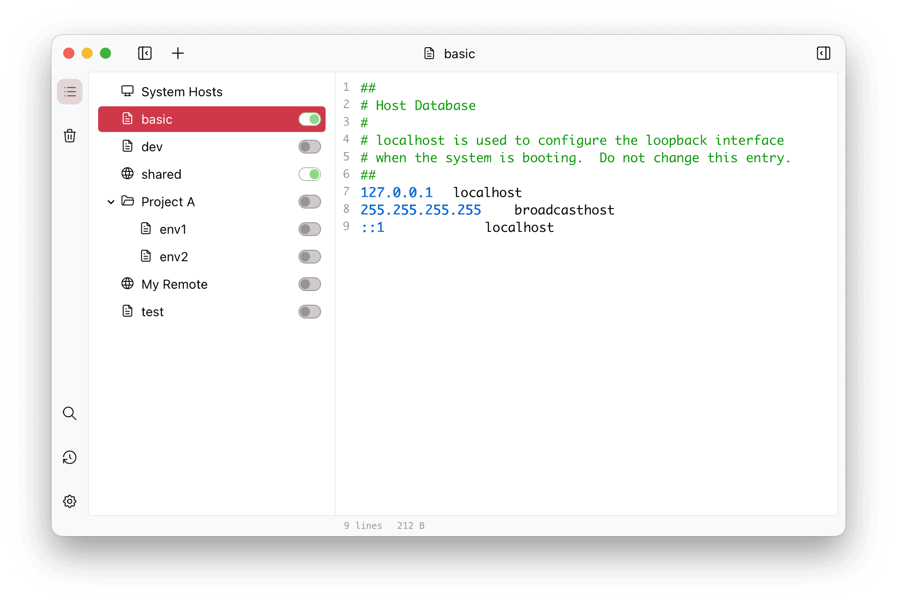

<div align="center" markdown="1">
  <sup>Special thanks to:</sup>
  <br>
  <a href="https://go.warp.dev/SwitchHosts">
    
  </a>

### [Warp, the intelligent terminal for developers](https://go.warp.dev/SwitchHosts)
[Available for MacOS, Linux, & Windows](https://go.warp.dev/SwitchHosts)<br>

</div>

---

# SwitchHosts

- [English](README.md)
- [Polski](README.pl.md)
- [繁體中文](README.zh_hant.md)

项目主页：[https://switchhosts.app](https://switchhosts.app)

SwitchHosts 是一个管理 hosts 文件的应用，基于 [Tauri](https://tauri.app/)、[React](https://facebook.github.io/react/)、[Jotai](https://jotai.org/)、[Mantine](https://mantine.dev/) 等技术开发。

## 截图



## 功能特性

- 管理系统、本地、远程、组合和文件夹 hosts 条目
- 可在主窗口或系统托盘快速切换 hosts 方案
- hosts 文件语法高亮
- 跨 hosts 条目查找和替换
- 支持手动、定时或启动时刷新远程 hosts
- 导入/导出 hosts 数据，并支持从 URL 导入备份
- 将条目移入回收站，并可稍后恢复或彻底删除
- 偏好设置支持写入模式、代理、更新检查、开机启动、应用后命令和本地 HTTP API

## 安装

### 下载

你可以下载源码并自行构建，也可以从以下地址下载已构建好的版本：

- [SwitchHosts Download Page (GitHub release)](https://github.com/oldj/SwitchHosts/releases)

你也可以通过 [Chocolatey 包管理器](https://community.chocolatey.org/packages/switchhosts)安装已构建好的版本：
```powershell
choco install switchhosts
```

## 数据备份

SwitchHosts 的数据文件存储于 `~/.SwitchHosts` (Windows 下存储于用户个人文件夹下的 `.SwitchHosts` 文件夹），
v5 数据结构如下：

- `~/.SwitchHosts/manifest.json` 存储 hosts 树
- `~/.SwitchHosts/entries/` 存储本地和远程 hosts 内容
- `~/.SwitchHosts/trashcan.json` 存储回收站条目
- `~/.SwitchHosts/internal/config.json` 存储偏好设置
- `~/.SwitchHosts/internal/histories/` 存储系统 hosts 和命令运行历史

如需完整手动备份，请复制整个 `~/.SwitchHosts` 文件夹。应用内导出会生成 hosts 数据备份 JSON，不包含偏好设置或历史记录。

系统 hosts 使用无 BOM 的 UTF-8 写入。转换已有的 Windows ANSI 或带 BOM 的 UTF-16 文件前，SwitchHosts 会将原始字节保存到当前数据目录的 `internal/histories/hosts-encoding-backups/`，即使关闭历史记录也会备份。这些 `.bin` 备份不受历史条数限制影响，也不包含在应用内导出的 JSON 中。

## HTTP 刷新的完成语义

`GET /api/refresh?id=<条目 ID>` 会等待远程内容获取、保存，并在内容发生变化时等待后端同步当前启用的 hosts 配置。系统写入可能需要 OS 授权弹窗；此请求没有覆盖授权等待的总超时，可能一直等待用户回应。配置的应用后命令还可能增加最多 30 秒的等待。

脚本客户端应自行设置请求超时。客户端超时不会取消后端任务，也不能据此判断刷新失败；重试前可在 SwitchHosts 中检查条目和恢复状态。`apply_failed` 响应可能同时包含 `changed: true` 和 `data` 中的最新条目，表示源内容已保存，但系统应用失败。若另一个应用操作尚待确认或恢复，内容同步会延后，因此刷新成功不保证延后的内容已经生效。

查找替换在源文件保存后返回。替换前会把待同步条目记录到 `internal/pending-content-sync.json`，启动时根据已保存的配置重试，核对同步成功后清除记录；主窗口未打开时也会执行。 若待同步记录损坏或被替换成目录，可使用“重新应用已保存的设置”进行恢复；核对同步成功后，异常记录会备份为 `pending-content-sync.invalid-*`，查找替换即可恢复。已保存的配置没有选中源时，恢复首先只读取并保留当前系统 hosts，不改变已有恢复状态。确认后，仍会重试此前已确认但尚未完成的选择同步，包括并发取消全部选择后的清理；仅 dirty 记录损坏不会授权这种空写入。普通开关操作关闭最后一个源时，仍会应用空选择。权限或暂时性 I/O 错误会保留原记录，需恢复访问权限后重试。

## 开发以及构建

### 前置要求

- [Node.js](https://nodejs.org/) 24 LTS
- [Rust](https://www.rust-lang.org/tools/install) >= 1.90
- Tauri 系统依赖，参见 [Tauri 前置要求](https://v2.tauri.app/start/prerequisites/)

### 开发

- 运行 `npm install` 安装依赖
- 运行 `npm run tauri:dev` 启动开发模式

### 构建及打包

- 运行 `npm run tauri:build` 进行生产构建
- 打包后的文件位于 `./src-tauri/target/release/bundle/`

```bash
# 开发
npm run tauri:dev

# 生产构建
npm run tauri:build
```

## 版权

SwitchHosts 是一个免费开源软件，基于 Apache-2.0 协议发布。
