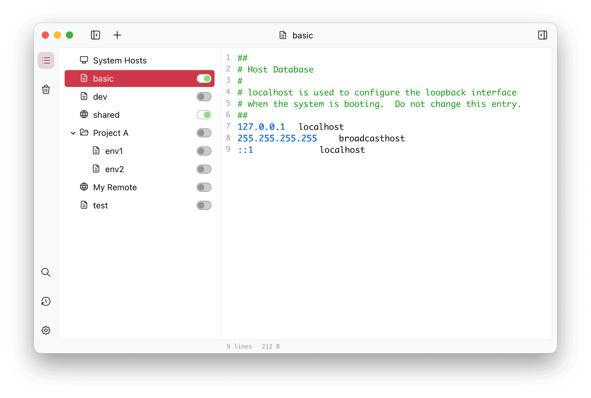

<div align="center" markdown="1">
  <sup>Special thanks to:</sup>
  <br>
  <a href="https://go.warp.dev/SwitchHosts">
    
  </a>

### [Warp, the intelligent terminal for developers](https://go.warp.dev/SwitchHosts)

[Available for MacOS, Linux, & Windows](https://go.warp.dev/SwitchHosts)<br>

</div>

---

# SwitchHosts

輕鬆管理和切換 hosts 檔案，基於 [Tauri](https://tauri.app/) 和 [React](https://react.dev/) 建構。

[專案首頁](https://switchhosts.app) · [English](README.md) · [简体中文](README.zh_hans.md) · [Polski](README.pl.md) · [Türkçe](README.tr.md)



## 功能特性

- 管理本機和遠端 hosts，支援組合與資料夾
- 從主視窗或系統匣快速切換 hosts
- 支援語法高亮、尋找和取代
- 自動重新整理遠端 hosts，匯入與匯出備份

## 下載

前往 [GitHub Releases](https://github.com/oldj/SwitchHosts/releases) 下載，或在 Windows 上透過 [Chocolatey](https://community.chocolatey.org/packages/switchhosts) 安裝：`choco install switchhosts`。

## 文件與開發

資料備份與建置環境要求詳見[使用與開發指南](docs/guide.zh_hant.md)；編輯 hosts 與本機 HTTP API 說明請參閱[英文指南](docs/guide.md)。

```bash
npm install
npm run tauri:dev    # 開發
npm run tauri:build  # 正式版建置
```

## 版權聲明

SwitchHosts 是一個免費開源軟體，基於 Apache-2.0 開源協議發佈。
